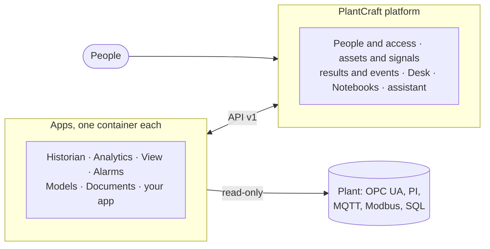

<picture>
  <source media="(prefers-color-scheme: dark)" srcset="docs/images/logo-dark.svg">
  
</picture>

# PlantCraft

**Industrial software for process engineers. Spend your time on the plant, not on building the tools.**

[Website](https://plantcraft.io) · [Live demo](https://demo.plantcraft.io) · [Install](docs/install.md) ·
[Getting started](docs/en/getting-started.md) · [Security guide](docs/security-guide.md)

PlantCraft is a complete, open suite: historian, analytics, alarms, dashboards and diagrams,
process models and plant documents in one place, built to work with AI. You ask, and the
assistant builds the method, the block, the rule or the dashboard. You go straight to where the
plant has a problem, and plan the fix with your team.

> ⭐ **If PlantCraft is useful to you, or you would like to see it grow, star this repository.**
> It is the simplest way to help an open industrial project get found.

## Open, Secure, LLM-first, Fast

- **Open: all code and methods.** Every line of code and every method is open (Apache-2.0), with
  no paid edition and no locked feature. A finding says how it was reached, and the algorithm
  behind it is blocks and Python you can read, change and share. Apps work together only through
  what they publish, so a new app for your process, your research or your client starts from the
  [app template](templates/app) and slots in beside the official ones.
- **Secure: offline, read-only.** It installs from one signed bundle with no internet, never
  writes to a DCS, PLC or historian, publishes one HTTPS port and asks for sign-in by default.
  No language model is called until an administrator sets one up. The
  [security guide](docs/security-guide.md) maps it to the Purdue model and IEC 62443.
- **LLM-first: ask, don't build.** Every page has an assistant that proposes the block, the
  algorithm, the alarm rule or the model with its fields filled in, and answers questions from
  the plant's own data, results and documents. Your own AI can read the plant too, through a
  read-only MCP server ([assistant access](docs/assistant-access.md)). It is off until an administrator connects a model: [turn it on](docs/assistant.md#turn-it-on).
- **Fast: value in days, not months.** The demo suite installs from the offline bundle in about
  ten minutes, and Analytics checks every loop and signal from its first round, the worst first,
  each with a sentence that says why ([sizing](docs/en/sizing.md)).

## The suite

One platform, every plant tool. Each app runs in its own container and shares the same people,
plant assets, signals and look; an installation picks the apps it needs.

| App | Folder | What it does |
| --- | --- | --- |
| PlantCraft Analytics | [`apps/link`](apps/link) | Scheduled monitors, diagnostics and KPIs for signals and control loops: finds bad data, oscillation, sticking valves and manual mode, and says why |
| PlantCraft Historian | [`apps/historian`](apps/historian) | The data layer: every plant connection (OPC UA, PI Web API, MQTT, Modbus TCP, SQL, CSV) and every history, read-only toward the plant |
| PlantCraft View | [`apps/view`](apps/view) | Dashboards, process diagrams, scheduled reports and saved trends of any signal, shared with people or by a public link |
| PlantCraft Alarms | [`apps/alarms`](apps/alarms) | Rules that raise ISA-18.2 alarms and alerts from signals and results, the Active list, history and alarm performance |
| PlantCraft Models | [`apps/models`](apps/models) | Block-diagram models (Modelica underneath): draw or write them, simulate them on plant data, run studies and export FMUs |
| PlantCraft Documents | [`apps/documents`](apps/documents) | The plant's documents in one library (manuals, P&IDs, procedures, maintenance records), linked to the assets and searched by words and meaning; the assistant cites document, revision and page |
| PlantCraft Simulator | [`simulator`](simulator) | The simulated plant (OPC UA) behind the demo and the benchmarks |
| App template | [`templates/app`](templates/app) | StarterCraft, the starting point for an app of your own: rules, tests and prompts for Claude Code, tried inside PlantCraft with `make dev` |

Desk (each person's day) and Notebooks (JupyterLab with the plant's data) are part of the
platform itself, at the root of this repository with the SDK ([`sdk/python`](sdk/python)) and the
shared interface ([`ui`](ui)). Ports, prefixes and versions: [docs/suite.md](docs/suite.md).

## How it fits together

The platform holds what every app shares; each app keeps only its own objects and methods and
talks to the platform through one contract, API v1. Apps never call each other: they publish
results and events and read what the others published. That is what lets anyone add an app
without touching the rest. The full picture, with how the apps find one sticky valve together:
[docs/architecture.md](docs/architecture.md).

## Try it

- **In your browser:** the [live demo](https://demo.plantcraft.io) runs the whole suite on a
  simulated plant.
- **On your own server:** [install PlantCraft](docs/install.md) from the offline bundle on Linux,
  macOS or Windows (`./install.sh --demo` adds the demo plant), then take the
  [Getting started](docs/en/getting-started.md) tour.
- **Questions:** ask the chat on [plantcraft.io](https://plantcraft.io), or write to
  [info@plantcraft.io](mailto:info@plantcraft.io).

## Documentation

Start with [Install PlantCraft](docs/install.md), the [Getting started](docs/en/getting-started.md)
tour, [the suite at a glance](docs/suite.md) and [how we build](docs/how-we-build.md). The full
index is in [docs/README.md](docs/README.md). The user guides are also in the app, under **Help**.

## Built with AI, in the open

PlantCraft is written almost entirely by [Claude Code](https://claude.com/claude-code), directed by
a process engineer who decides what to build, reviews the results and owns every decision. We say
so openly: it is how industrial software can reach researchers and process engineers who would
never get a licence for it, and it is why the rules are strict. One standard for every module,
tests that fail on network access, junk input, upward imports and slow tests, oracles on public
data, and a security audit per stage ([AGENTS.md](AGENTS.md), [how we build](docs/how-we-build.md)).

## Contribute

Bug reports, methods, translations, docs and apps are all welcome. Start by finding where your
change lands:

| You want to | Where | First |
|---|---|---|
| Fix a bug or improve one app | `apps/<app>/` | A pull request, with `make ci` green in that folder |
| Add a method, a block, an algorithm or an example | Inside the app that owns it | A pull request with its public reference and tests |
| Change the platform, the SDK, the shared interface or API v1 (the **core**) | `plantcraft/`, `sdk/`, `ui/`, `frontend/` | **An issue**, and a maintainer's agreement on the approach |
| Build an app for your process or client | Your own repository, from [`templates/app`](templates/app) | Nothing here: it installs as a signed package |

The rules, the checks and how a pull request is reviewed: [CONTRIBUTING.md](CONTRIBUTING.md).
Running it from source, the command line and the settings: [docs/development.md](docs/development.md).
To report a vulnerability, see [SECURITY.md](SECURITY.md). Everyone in the project follows the
[code of conduct](CODE_OF_CONDUCT.md).

PlantCraft is in alpha. If it helps you, ⭐ **star the repository** and tell us what you run it on.

News and release notes: [X](https://x.com/plantcraft_io) · [YouTube](https://www.youtube.com/@plantcraft_io) · [plantcraft.io](https://plantcraft.io).

## License

Apache License 2.0. See [LICENSE](LICENSE) and [NOTICE](NOTICE). The names and logos are not
part of the license: see [TRADEMARKS.md](TRADEMARKS.md).
