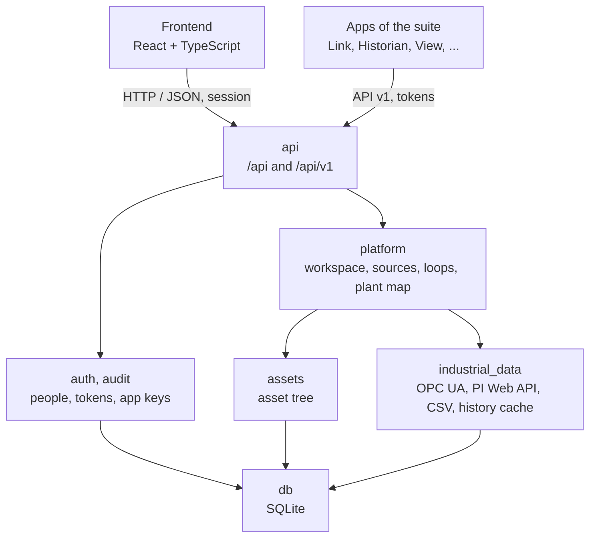

# Architecture

PlantCraft is the central app of the suite: a Python package
(`processcraft/`) with a FastAPI backend and a React + TypeScript frontend
(`frontend/`). State lives in one local SQLite database. The apps of the suite
(Analytics, Historian, View, Alarms, Models) are separate programs, each in its own folder of this
repository (`apps/<app>`) with its own image, that reach PlantCraft through API v1 only. This document explains how the code is split
and the rules that keep it that way.

## Philosophy

- **One place for what every app shares.** People and their access, data
  sources, signals and the asset tree live here once; an app never keeps its
  own copy of the plant or its own user directory.
- **Apps talk through a contract.** API v1 (`docs/api-v1.md`) is the only way
  an app reaches PlantCraft, and `sdk/python` (`plantcraft-sdk`) is the
  only code apps import from it. PlantCraft never imports an app.
- **PlantCraft never writes to the process.** It reads the plant's
  historians; it never writes to a controller.
- **Offline and on premises.** No outbound network beyond the data sources an
  administrator configures (`tests/test_offline.py`).

## Layers

Code is split into modules that only import downward: a module may import from
its own package or from a lower layer, never from a higher one. Modules in the
top layer may import each other. `tests/test_architecture.py` enforces this and
fails on any violation; its `LAYERS` table and the one below must agree. Its
`MOVED` table lists the packages that left for the apps; nothing may import
them again.

| Layer | Modules | Role |
| --- | --- | --- |
| 0 | `db`, `config`, `refs`, `i18n`, `files` | Shared SQLite store and scenarios; `kind:id` references; interface language and translation catalogs; files written whole, created with their final mode |
| 1 | `industrial_data`, `auth`, `assets`, `events`, `audit`, `apps`, `results`, `compute`, `groups`, `notebooks`, `installation` | Data sources (CSV, PI Web API, OPC UA) and the history cache; people, access, token keys, app keys and the suite's apps; asset tree; events; central audit log; signed app packages, the installer service and the Apps page's logic; the results, runs and schedules the apps publish; the compute workers and the queue of tasks the apps hand them; groups of people; the notebooks switch and the notebooks written for each person; the installation's time zone (Settings › Installation) |
| 2 | `platform`, `notify`, `desk` | Workspace (the stores), source registry, scenario loops as assets, plant map import and export; the apps' notifications to people (Messages and the email outbox); Desk, each person's day (to-dos, own events, followed assets, calendars) |
| 3 | `api`, `cli` | HTTP (the interface's `/api` and API v1), command line |

The demo plant is the Simulator, its own product (`simcraft loops serve`, namespace
`urn:processcraft:plantcraft`): PlantCraft reads it over OPC UA like any other server and
never imports it. `processcraft/simulator` moved there (gap G31, closed 2026-10-19).

Each module owns its tables: a `Store` subclass (`processcraft/db.py`) with a
`SCHEMA` string. A change to a table a release already shipped is a named step in
the store's `MIGRATIONS` (`Migration`, `add_columns` from `plantcraft_sdk.server.store`):
each runs once per database and is recorded in `sdk_migrations`, so an installation that
skipped releases runs every step it missed, in order. `tests/test_upgrade_schema.py` opens
the schema of every published release (`tests/schemas/`) and expects today's tables. A database from the
monolith opens as is: the tables of the removed modules stay untouched.

## The apps of the suite

- `PLANTCRAFT_APPS` lists the apps installed beside PlantCraft
  (`linkcraft=/link/@0.1.0,...`, `processcraft/auth/suite.py`). The launcher on
  the home page shows each one, locked for a person whose access does not
  include it.
- A person signs in here. PlantCraft issues a short-lived Ed25519 token
  (`processcraft/auth/tokens.py`) and keeps it fresh in the
  `processcraft_token` cookie; an app verifies it offline against
  `/api/v1/keys`.
- Background work (Analytics' schedules) uses a service token obtained with an
  app key (`processcraft/auth/app_keys.py`), which an admin issues under
  **Settings → Users and app keys**.
- Every write an app makes through API v1, and every app key change, is
  recorded in the central audit log (`processcraft/audit`).
- Apps link only through PlantCraft (`docs/app-standard.md`, section 6):
  they publish **results** about assets and signals and **events**, and
  report their **runs** and **schedules** (`api/routers/v1_links.py`, stored
  by `processcraft/results` and `processcraft/events`). The Executions page
  shows every app's runs and schedules, read-only.
- A person's apps may name an app by its id (`linkcraft`) or by the module it
  grew from inside the monolith (`cpm`), so access granted before the split
  keeps working (`FORMER_IDS`).

## Loops

PlantCraft does not analyse loops; it describes them. A loop is an asset of
kind `loop` whose signals carry roles (`pv`, `sp`, `op`, `mode`, `secondary`).
They come from three places, each with its own origin:

- the scenario file's `loops` (origin `scenario`, kept in step by
  `processcraft/platform/loops.py` at every start);
- the plant map's `loops` sheet (origin `map`);
- a person, in the asset tree (origin `manual`, never changed by a sync).

Analytics reads every loop asset with its signals through `GET /api/v1/assets`.
The loop's analysis settings (algorithm, criticality, enabled methods) are
Analytics': the map ignores those columns with a warning.

## Data sources

Connectors in `processcraft/industrial_data` (OPC UA Historical Access, PI Web
API, CSV) implement `read_window` and `read_range`, normalize timestamps to the
scenario time zone, isolate failures per tag and return a wide `DataFrame`
indexed by time. Reads go through a local history cache in SQLite, and each tag
is read from the source that owns it. On start, PlantCraft fills the cache
for the last 48 hours of the scenario's signals in the background
(`PLANTCRAFT_PREWARM_HISTORY`).

## Interface language

English is the source language of every user-facing string; Brazilian
Portuguese is a translation. The backend uses `t()` from `processcraft.i18n`,
the frontend `t()` from `frontend/src/i18n.ts`, and the English text is the
catalog key.

## Anti-patterns

- PlantCraft importing an app, or naming one outside `auth/suite.py`.
- An app reaching the database or a source directly instead of API v1.
- A second copy of a contract (`_v2`) instead of an additive change.
- Analysis code (methods, scores, diagnoses) coming back into PlantCraft:
  it belongs to an app.

## Acceptance checklist for a change

- Which layer owns the logic, and which store owns its table?
- Does it change API v1? Then `docs/api-v1.md`, the contract tests and
  `FakePlantCraft` change in the same commit, additively.
- Can it be tested without the frontend and without a live data source?
- Does `make ci` pass?
