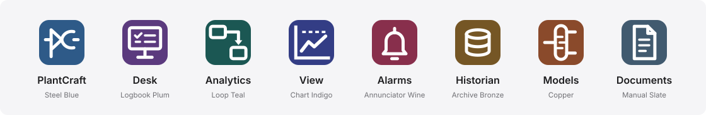

# PlantCraft brand guide

PlantCraft is a working tool for process engineers. It runs on control-room
screens and engineering laptops in refineries and plants, often for hours. The
identity is built for that: **precise, calm, trustworthy, engineered**. It
should look like good instrumentation, not like a marketing site: flat
surfaces, one typeface, neutral greys, colour only where it means something.

Everything visual is defined as design tokens in
[`ui/src/tokens.css`](../ui/src/tokens.css) (`@plantcraft/ui`), which every app
of the suite imports. Components use those variables and never hard-code a
colour, font or radius.

## Name

- Write **PlantCraft**: one word, capital P and capital C.
- Do not write "Plant Craft", "Plantcraft", "PLANTCRAFT" or "PC".
- The suite was called ProcessCraft until 2026-10-27. The code, the command and the release files
  say `plantcraft` (the Python package since 0.5.1; `processcraft` still runs as an alias). Image
  and service names, data ids, cookies and URLs inside an installation keep `processcraft`, so
  existing installations and their data never change. The plant simulator is the
  **Simulator** ("PlantCraft Simulator" in documents).
- The name is not translated. In Portuguese text it stays "PlantCraft".

## Logo


The mark is the letters **P** and **C** drawn as a **control valve** on a **process line**
(2026-10-30): the bowl of the P is the valve triangle, the line runs into the P and out of
the open C, the way the valve sits on a P&ID. It reads as the name and as plant equipment
at once, and it holds at 16 px. Ready-made PNGs, the LinkedIn avatar and banner are in
[`brand/`](../brand/).

| File | Use |
| --- | --- |
| [`docs/images/logo.svg`](images/logo.svg) | Lockup on light backgrounds (README, documents) |
| [`docs/images/logo-dark.svg`](images/logo-dark.svg) | Lockup on dark backgrounds |
| [`docs/images/logo-mark.svg`](images/logo-mark.svg) | Mark alone (same as `frontend/public/favicon.svg`) |
| [`docs/images/social.svg`](images/social.svg), `social.png` | Link preview (Open Graph, 1200 x 630) |
| `BrandMark`, `BrandLockup` in [`ui/src/Brand.tsx`](../ui/src/Brand.tsx) | The interface |

In the wordmark "Plant" is set in Inter Regular and "Craft" in Inter SemiBold,
so the name reads as one word with the emphasis on the craft. The files draw
the name as outlines and need no font; `dev/brand-logos` writes them from
`ui/src/appMarks.ts`.

- Keep clear space around the lockup equal to half the mark's height.
- Minimum size: mark 16 px; lockup 96 px wide.
- The tile is always Steel Blue (`#2E5A88`; `#3D78B6` on dark backgrounds) with a white glyph. On a single-colour
  medium (engraving, fax, one-colour print) use the glyph alone in black or white.
- Do not recolour the tile, add gradients, shadows, highlights or outlines,
  rotate the mark, or set the name in another typeface.

### README header

Every repository's README opens the same way: the PlantCraft lockup (light and dark), then the
app's name as the only `#` heading, then one sentence on what it does.

```html
<picture>
  <source media="(prefers-color-scheme: dark)" srcset="docs/images/logo-dark.svg">
  
</picture>

# PlantCraft Analytics
```

## App family



PlantCraft is the platform; each app has its own mark. All marks share one
tile and one drawing grammar, so the family reads as a suite while every app
is recognisable at a glance, in the app switcher at 22 px and on a launcher at
128 px.

| Source | Use |
| --- | --- |
| [`ui/src/appMarks.ts`](../ui/src/appMarks.ts) | The one source: ids, names, tile colours, glyphs |
| `AppMark`, `AppLockup` in [`ui/src/Brand.tsx`](../ui/src/Brand.tsx) | The interface: `<AppMark app="linkcraft" size={32} />` |
| `APP_COLORS`, `appColor()` in [`ui/src/brandTheme.ts`](../ui/src/brandTheme.ts) | Hex values for Plotly and canvas |
| `--pc-app-<id>` in [`ui/src/tokens.css`](../ui/src/tokens.css) | Tile colours for CSS, light and dark |
| [`docs/images/apps/<id>.svg`](images/apps/), `family.svg`, `family-dark.svg` | Standalone files, generated |

An app outside the family (a company's own, made from `templates/app`) draws the same tile in a
neutral grey (`--pc-text-3`, never a status hue) with the first letter of its name in white:
`<SuiteShell app="starter" appName="StarterCraft">` (ui 0.29.0).

Regenerate the standalone files after changing `appMarks.ts`:
`node --experimental-strip-types ui/src/appMarks.render.mjs`, then `dev/brand-logos`.
Machine ids served today map to the family in `APP_ID_BY_MACHINE_ID`
(`cpm`, `cpmcraft`, `data_quality`, `datacraft`, `twincraft` -> linkcraft; `dashboards`,
`trendcraft` -> dashcraft; `simulator`, `plantcraft` -> simcraft).

### Tile

- 32 x 32 grid, corner radius 7, one flat colour, white glyph. Same as the
  PlantCraft mark; never a gradient, shadow, highlight, outline or second colour.
- The glyph keeps 4 units clear of the tile edge (the process line of the
  platform mark is the only element that reaches the margin).
- One-colour media: the glyph alone in black or white (`variant="glyph"`).

### Names

Only the platform carries the Craft brand. An app is **PlantCraft <name>** in documents, packages
and proposals (PlantCraft Analytics, PlantCraft Historian, PlantCraft View, PlantCraft Alarms,
PlantCraft Models) and just **<name>** inside the suite: the app switcher, the sidebar lockup
and the launcher show short names (`appShortName`). Ids, repositories, images and URL prefixes
keep their machine form (`linkcraft`, `/link/`). `APP_NAMES` holds the short names and
`appFullName()` the long ones.

### Palette

Tiles are deep colours: the white glyph has at least 4.5:1 contrast in both
themes, and the hues stay away from the status colours. Dark values are one
step lighter so the tile holds on dark surfaces. A tile colour is used for its
app's mark and nothing else.

| App | Machine id | Colour | Light | Dark | Glyph |
| --- | --- | --- | --- | --- | --- |
| PlantCraft | `processcraft` (app id) | Steel Blue | `#2E5A88` | `#3D78B6` | P and C as a control valve on a line |
| Desk | `desk` | Logbook Plum | `#5B3A7E` | `#8B62B7` | Console with the day's checklist |
| Analytics | `linkcraft` | Loop Teal | `#1B5753` | `#28807A` | Two blocks connected |
| View | `dashcraft` | Chart Indigo | `#333D85` | `#636EC3` | Trend on a chart frame under a dashed limit |
| Alarms | `alarmcraft` | Annunciator Wine | `#882F4C` | `#C14C72` | Bell |
| Historian | `histcraft` | Archive Bronze | `#755625` | `#946D2F` | Data cylinder |
| Models | `modelcraft` | Copper | `#8A4A2B` | `#B15F37` | Distillation column with trays, feed, top and bottom lines |
| Documents | `doccraft` | Manual Slate | `#415A6F` | `#577894` | Page with a folded corner and lines of text |
| Simulator | `simcraft` | Equipment Olive | `#536020` | `#6A7B29` | Column (the plant simulator; not shown in the family) |

Tile colours were toned toward Steel Blue on 2026-10-30: same hues, less saturation. Dark values
are the lightest that keep 4.5:1 under the white glyph, so tiles also hold on black.

### Glyph grammar

- Flat line art in the ISA-5.1 spirit of the platform mark: equipment,
  instruments and signals the way an engineer sketches them, never
  illustrations, pictures or letters.
- Main strokes 2.2 to 2.4 units (2.8 only for a check mark), secondary strokes
  1.6 to 1.8, nothing thinner. Solid fills only for arrowheads, valve bodies
  and the bell.
- Dashed strokes mean "reference, limit or virtual" (setpoint, alarm limit),
  nothing else.
- Two or three elements per glyph; one carries the idea, the others give it
  context. If it does not read at 16 px, remove detail.

### Do and don't

| Do | Don't |
| --- | --- |
| Use `AppMark` wherever an application is listed (switcher, cards, filters) | Draw an app icon with a generic icon set |
| Keep the app's tile colour for its mark and lockup only | Use a tile colour for status, chart series or panels |
| Put the mark next to the written name | Rely on the tile colour alone to tell apps apart |
| Add a new app by extending `appMarks.ts`, `tokens.css` and this table together | Recolour, rotate, add letters or effects to a mark |

## Colour

Colour follows the high-performance HMI approach (ISA-101): surfaces are calm
neutral greys; **Steel Blue** marks what you can act on; the status hues
are **reserved for state** and never used for decoration, so an operator's eye
goes straight to the abnormal.

### Brand

| Token | Light | Dark | Use |
| --- | --- | --- | --- |
| `--pc-primary` | `#2E5A88` | `#3D78B6` | Buttons, selection, links |
| `--pc-primary-hover` | `#264B71` | `#4F88C2` | Hover and pressed |
| `--pc-primary-text` | `#2B5582` | `#7FA6D1` | Links and accents as text |
| `--pc-primary-soft` | `#E8EEF5` | `#1C2A3B` | Selected rows, active tabs |
| `--pc-focus` | `#44729F` | `#7FA6D1` | Focus outline |
| `--pc-chrome-bg` | `#1C1C1E` | `#1C1C1E` | Sidebar (graphite in both themes) |
| `--pc-chrome-accent` | `#7FA6D1` | `#7FA6D1` | Current page and app in the sidebar |

Blue is the one hue a control system does not spend on alarms (red, amber,
yellow) or running state (green), so the brand never competes with a process
signal.

### Neutrals

| Token | Light | Dark |
| --- | --- | --- |
| `--pc-bg` (canvas) | `#F5F5F7` | `#000000` |
| `--pc-surface` (cards, inputs) | `#FFFFFF` | `#1C1C1E` |
| `--pc-surface-2` (table heads, hover) | `#FAFAFC` | `#232326` |
| `--pc-surface-3` (tracks, chips) | `#F0F0F3` | `#2C2C2E` |
| `--pc-border-subtle` | `#E8E8ED` | `#2C2C2E` |
| `--pc-border` | `#D2D2D7` | `#38383A` |
| `--pc-text` (headings, values) | `#1D1D1F` | `#F5F5F7` |
| `--pc-text-2` (body) | `#424245` | `#D2D2D7` |
| `--pc-text-3` (secondary, AA) | `#636368` | `#98989D` |
| `--pc-text-4` (quiet text, placeholder, icons; AA since ui 0.52.0) | `#6E6E73` | `#8E8E93` |

### Status

Each state has a `fill` (dots, bars, chart markers), a `text` (AA contrast on
its soft background and on the surface) and a `soft` background. Always pair
the colour with a label or icon; colour never carries the meaning alone.

| State | Token prefix | Fill light / dark | Text light / dark | Soft light / dark |
| --- | --- | --- | --- | --- |
| Good | `--pc-good-*` | `#34C759` / `#30D158` | `#1F7A36` / `#63E07F` | `#E9F8ED` / `#12291A` |
| Attention | `--pc-attention-*` | `#FF9F0A` / `#FF9F0A` | `#935000` / `#FFB84D` | `#FFF4E0` / `#2E2210` |
| High priority | `--pc-serious-*` | `#F2690D` / `#FF7A2E` | `#A3440A` / `#FF9D66` | `#FFEEE3` / `#3A2214` |
| Problem, offline | `--pc-problem-*` | `#FF3B30` / `#FF453A` | `#C4111F` / `#FF7B72` | `#FFECEB` / `#3A1716` |
| Inactive, no news | `--pc-inactive-*` | `#8E8E93` / `#8E8E93` | `#636366` / `#A1A1A6` | `#F0F0F3` / `#2C2C2E` |
| Data not usable | `--pc-unusable-*` | `#AF52DE` / `#BF5AF2` | `#8A2FB8` / `#D38CF7` | `#F7EDFC` / `#2E1A38` |
| Information | `--pc-info-*` | `#32ADE6` / `#64D2FF` | `#0B6A94` / `#7FD8FF` | `#E6F6FD` / `#0F2A38` |

A source or app that sent nothing for a while ("no news", "unknown") is grey,
not an alarm; one that is offline is red. Purple for "data not usable" follows
the DCS convention for bad-quality signals: it is visibly *not* a process state.

### Charts

Eight series colours, used **in this order** and never cycled. The order was
validated for colour-vision deficiency in both themes (adjacent-pair CVD
ΔE ≥ 10.7, normal-vision ΔE ≥ 18.9). Beyond eight series, group the rest as
"Other" or split the chart.

| # | Light | Dark | Typical use |
| --- | --- | --- | --- |
| 1 | `#1762B6` blue | `#4087DE` | PV |
| 2 | `#E06D00` orange | `#E06D00` | SP |
| 3 | `#00958F` teal | `#04A19B` | OP |
| 4 | `#654DB6` violet | `#8A74E2` | |
| 5 | `#CFA529` gold | `#B48A00` | |
| 6 | `#913E20` rust | `#A95436` | |
| 7 | `#CA488F` magenta | `#D14E95` | |
| 8 | `#438F31` green | `#499537` | |

Plotly cannot read CSS variables, so the same values live in
[`ui/src/brandTheme.ts`](../ui/src/brandTheme.ts) (`plotTheme()`, `statusColors()`);
change both files together. Gridlines use `--pc-chart-grid`; one y-axis per chart.

## Typography

| Role | Family | Token |
| --- | --- | --- |
| Interface, headings, numbers | **Inter** (variable, 100 to 900, optical sizes) | `--pc-font-sans`, `--pc-font-display` |
| Tags, raw values, units, code | **JetBrains Mono** 400 / 500 | `--pc-font-mono` |

Inter is neutral, has true tabular figures and an unambiguous `0 O 1 l I`;
its optical sizes keep small labels open and large titles tight. JetBrains
Mono matches it when a screen mixes loop tags (`FIC-101.PV`) with prose. Both
ship inside `@plantcraft/ui` (`ui/src/fonts/`), because plants run without
internet; nothing is loaded from a font service. Licence: SIL Open Font
License (`ui/src/fonts/OFL-*.txt`).

Numbers are tabular everywhere (`font-variant-numeric: tabular-nums`) so
columns of values align. Use `.pc-mono` for tags and raw values.

### Scale

| Role | Size / weight | Token | Class |
| --- | --- | --- | --- |
| Page title | 28 / Bold, tracking -0.022em | `--pc-fs-4xl` | `.page-heading h1` |
| Section title | 20 / SemiBold, tracking -0.012em | `--pc-fs-xl` | `.section-title` |
| Highlight, panel title | 16 / SemiBold | `--pc-fs-lg` | `.panel-header h2`, `.card-head h2` |
| Body | 14 / Regular | `--pc-fs-md` | |
| Card label, crumb, dense text | 13 / Medium | `--pc-fs-sm` | `.eyebrow`, `.pc-wg-card-head h2` |
| Caption, table head | 12 / Regular or SemiBold | `--pc-fs-xs` | `.table th` |
| Big number (KPI) | 28 / SemiBold, tabular | `--pc-fs-3xl` | `.kpi-value` |
| Data (tags, values) | 13 / JetBrains Mono | `--pc-fs-sm` | `.pc-mono` |

Text is in **sentence case**: titles, buttons, card labels and table heads
start with a capital and continue in lower case. No uppercase labels with
wide tracking; the small grey line above a page title is a crumb (where you
are), not an overline. Weights stop at Bold (700) for page titles; everything
else is Regular, Medium or SemiBold.

Documents, the site and slides use the same two families: Inter for text,
JetBrains Mono for tags and code.

## Shape, space and motion

- Radii: 4 · **6 (controls)** · **8 (cards)** · 10 · 14 (dialogs) px.
- Spacing follows a 4 px grid (`--pc-space-1` … `--pc-space-12`).
- Screens are flat: cards use a hairline border; only menus and dialogs float
  (`--pc-shadow-3`, `--pc-shadow-4`). No gradients, gloss or relief.
- Motion is short and functional (120–260 ms, `--pc-ease`), and is removed
  under `prefers-reduced-motion`.
- Focus is always visible: a 2 px `--pc-focus` outline or `--pc-focus-ring`.

## The frame

Every app draws the same frame (`SuiteShell`, `docs/app-standard.md` section 10):

- **Sidebar**, graphite in both themes. At the top, the app's name opens the
  **app switcher** (Desk first, the apps in the order they are used, PlantCraft
  last, set apart). Then the app's pages, Help last.
- At the bottom: the person (their menu), **Messages** (an icon with a red
  count of unread messages; it opens the Desk inbox) and the **fold** button,
  always in that corner; the `[` key folds and unfolds the menu too.
- A new message shows a short notice in the bottom right corner, and the tab
  title starts with the count: `(2) Overview · Link · PlantCraft`.

## Themes

Light is the default. Dark follows the operating system, and
`<html data-theme="dark">` (or `"light"`) overrides it. A subtree can force a
theme with `data-theme`; the wall-screen dashboard does this with
`.ac-screen-dark`. The sidebar is graphite in both themes.

## Display size

Beside the theme, the person's menu has a **display size** with five steps, from **Larger text**
to **More space** (`displaySize.ts`, `DisplaySizePicker`). Larger text is for people who read
the screen from further away or see less well; More space fits more of a page on a small laptop.
One choice covers every app (like the theme, it is kept in the browser).

The step goes on `<html data-size="1..5">` (none = the default, 3) and sets two scales in
`tokens.css`: `--pc-text-scale` multiplies the type tokens (`--pc-fs-*`, never under 10 px) and
`--pc-space-scale` the spacing tokens (`--pc-space-*`). Nothing is zoomed, so pop-up positions,
viewport units, drag and chart hover stay exact. So that a page follows:

- Type uses `--pc-fs-*`. A size the scale has no token for is written
  `calc(13.5px * var(--pc-text-scale, 1))`.
- Padding, margin and gap use `--pc-space-*`, or `calc(Npx * var(--pc-space-scale, 1))`.
  `dev/space-tokens <css files>` rewrites plain pixel values that way (1 and 2 px stay as they are).
- Plotly charts take their type sizes from `plotTheme()` and `plotFontSize()`; `useBrandTheme()`
  re-renders a chart when the size changes.
- Drawings with their own geometry (block diagrams, process diagrams) keep fixed sizes.
- The card grid's rows (`gridRow()`, `gridGap()`) follow the text, so a card holds at every size
  what it holds at the default; a widget list measures how many rows fit and never cuts one.
- Code that measures itself (a calendar, a chart) listens to `resize`: a size change sends one.

**Checked, not looked at.** A page is written once, at the default. `plantcraft_sdk.displayfit`
opens every page of an app's menu and a few pages under each, on a 1366x768 laptop and a
1920x1080 screen, at the five sizes, and fails on text a box cuts, text out of its card, button or
cell, text drawn over other text, or a page wider than the screen. Every app (and the template)
runs it in `tests/e2e/test_display_sizes.py`; PlantCraft's own pages in
`tests/e2e/test_display_sizes.py`. Text shortened on purpose uses an ellipsis or a line clamp, or
says so with `data-clip-ok`.

| Step | Name | Text | Space |
|---|---|---|---|
| 1 | Larger text | 125 % | 115 % |
| 2 | Large | 112 % | 107 % |
| 3 | Default | 100 % | 100 % |
| 4 | Compact | 93 % | 85 % |
| 5 | More space | 86 % | 72 % |

## Voice

- Write like a senior process engineer talking to a colleague: direct,
  specific, unhurried. Say what was measured, what it means, and what to do.
- Use the plant's vocabulary: loop, tag, PV, SP, OP, valve, oscillation,
  stiction. Do not invent product jargon.
- State uncertainty honestly ("not enough data in this window") rather than
  showing a confident number.
- No exclamation marks, hype or emojis.
- English is the source language; Brazilian Portuguese is a full translation.

## Do and don't

| Do | Don't |
| --- | --- |
| Use tokens (`var(--pc-…)`) for every colour, font and radius | Hard-code hex values in components |
| Reserve green, amber, red and purple for state | Use a status colour for a chart series or a decoration |
| Pair every status colour with a label or icon | Rely on colour alone |
| Keep large areas neutral; let colour mark exceptions | Fill panels with brand blue or gradients |
| Write in sentence case | Set labels in uppercase with wide tracking |
| Use JetBrains Mono for tags and raw values | Mix in other typefaces |
| Use the series colours in order | Cycle or pick series colours at random |
| Test screens in both themes | Assume white backgrounds |
