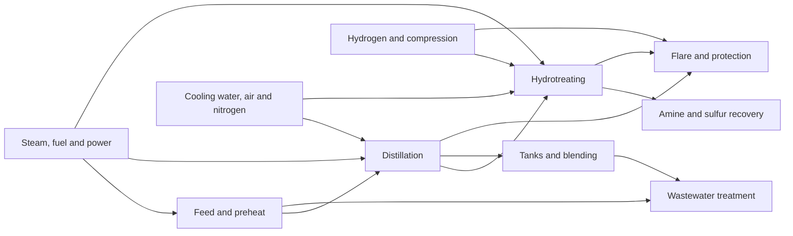

<p align="center"></p>

# PlantCraft Simulator

An OPC UA process plant simulator, as an app of the
[PlantCraft](https://github.com/PlantCraft/PlantCraft) suite.

[](https://github.com/PlantCraft/PlantCraft/actions/workflows/simulator.yml)
[](LICENSE)

PlantCraft Simulator gives the suite, and anyone testing industrial software, a plant to read from
without touching a real one. It publishes simulated control loops and process signals through
OPC UA Data Access and Historical Access, with history from the moment it starts. Everything it
serves is synthetic and deterministic: the same seed gives the same values.

It ships two simulators behind one command and one OPC UA namespace:

| | `simcraft loops serve` | `simcraft serve` |
|---|---|---|
| What | The 50-loop portfolio the PlantCraft demo reads | The plant-wide research benchmark |
| Size | 50 loops, 205 tags (`CPM.Loops.<LOOP>.PV/SP/OP/MODE`) | 50 loops, 500 signals, 20 scenarios (`Plant.*`) |
| Behaviour | One known behaviour per loop: healthy, oscillation, stiction, saturation, manual, noise, setpoint activity, sensor drift, disturbance, interaction | Coupled grey-box plant with controller, actuator, sensor, process and communication faults, hidden ground truth, offline datasets |
| History | 48 hours backfilled, then live every second | Per runtime profile (`smoke`, `development`, `paper`, `stress`) |
| Used by | PlantCraft demo, PlantCraft Analytics and Historian tests | Research, method evaluation, integration tests |

OPC UA namespace URI for both: **`urn:processcraft:plantcraft`**. Clients resolve the
namespace index from this URI; never assume `ns=2`.

## How it fits the suite

```text
PlantCraft Simulator (OPC UA, port 4840) ──> PlantCraft and its Historian (OPC UA sources, signals, assets) ──> apps
```

PlantCraft and PlantCraft Historian are the only parts of the suite that talk to plant
systems; they read PlantCraft Simulator like any other OPC UA server. In the suite PlantCraft Simulator runs as the
`simcraft` service of PlantCraft's `deploy/compose.yaml` (profile `demo`), on the internal
`demo` network only (no route out of the host), built from this repository's `Dockerfile`
(`make image`). PlantCraft Simulator is the only write target the suite
allows (AGENTS.md); it accepts no writes from clients today.

## Run it

```sh
python -m venv .venv && . .venv/bin/activate
python -m pip install -e '.[test]'
simcraft loops serve                  # opc.tcp://127.0.0.1:4840/plantcraft/
simcraft loops catalog                # every loop and its tags, as JSON
simcraft serve --profile development  # the benchmark instead
```

With Docker (read-only, uid 10004, port on host loopback only):

```sh
make image            # simcraft:0.4.0
docker compose up     # the loop portfolio; see compose.yaml for the benchmark
```

| Variable | Default | Meaning |
|---|---|---|
| `SIMCRAFT_ENDPOINT` | `opc.tcp://127.0.0.1:4840/plantcraft/` (`0.0.0.0` in the image) | Bind endpoint of either server |
| `SIMCRAFT_HISTORY_DB` | `var/opcua-history.sqlite3` (`/data/...` in the image) | Loop portfolio historian |
| `SIMCRAFT_STATE_DB` | `var/opcua-state.sqlite3` (`/data/...` in the image) | Loop portfolio dynamic state |
| `SIMCRAFT_HISTORY_HOURS` | `48` | History backfilled on a fresh start |
| `SIMCRAFT_HISTORY_SAMPLE_SECONDS` | `30` | Backfill step |
| `SIMCRAFT_REALTIME_SECONDS` | `1` | Live update period |
| `SIMCRAFT_HISTORIAN_SECONDS` | `5` | Live historian sampling |
| `SIMCRAFT_NAMESPACE_URI` | `urn:processcraft:plantcraft` | Transition only: serve the loops under another URI |
| `SIMCRAFT_LOG_LEVEL` | `INFO` | Log level of the loop portfolio |
| `SIMCRAFT_HEALTH_ENDPOINT` | `opc.tcp://127.0.0.1:4840/plantcraft/` | Endpoint the health check reads |
| `SIMCRAFT_MAX_SAMPLE_AGE_SECONDS` | `60` | Oldest value the health check accepts |

The full list is in [OPC UA interface](docs/opcua-interface.md).

## Develop

`make ci` runs what CI runs: ruff, the catalog check, pytest (both servers through a real
`asyncua` client, contracts, architecture) and the package build. Read [AGENTS.md](AGENTS.md)
before changing anything; [SPEC.md](SPEC.md) and [ROADMAP.md](ROADMAP.md) say what is done.

# The benchmark

A deterministic, open-source, plant-wide process-control benchmark with **50
control loops**, **500 temporal signals**, **20 operating and failure
scenarios**, hidden ground truth, offline dataset generation, and an OPC UA
Data Access/Historical Access server.

It is intended for research, education, integration testing, control
performance monitoring, anomaly detection, fault detection and isolation, and
industrial time-series quality studies.

> **Scientific scope:** this is a transparent grey-box benchmark, not a
> first-principles refinery design simulator and not a substitute for process
> safety or engineering calculations. All data are synthetic.

## Why this benchmark

Classical benchmarks established the value of reproducible plant-wide process
problems and actuator-fault datasets. This project extends that tradition with
a larger, inspectable signal surface and standards-based OPC UA transport:

- a connected refinery-like topology spanning ten process and utility areas;
- feedback, cascade, ratio, inventory, split-range, selector, supervisory, and
  plant-master control structures;
- controller, actuator, sensor, process, and communication failure layers;
- explicit value, quality, source timestamp, and cadence behavior;
- separate observation and hidden-truth artifacts to prevent label leakage;
- deterministic seeds and SHA-256 digests for exact reproduction.

The scientific formulation and limitations are documented in
[Scientific model](docs/scientific-model.md), with executable structure details
in [Control structures](docs/control-structures.md). A concrete paper plan is in
[Research protocol](docs/research-protocol.md). Measured pre-release evidence is
recorded in [Validation](docs/validation.md), and the transport contract is in
[OPC UA interface](docs/opcua-interface.md). Machine-readable formats, time
semantics, compatibility, and profiles are defined in
[Versioned contracts](docs/contracts.md).

Release support, upgrade behavior, artifact verification, and the publication
gate are defined in [Release and compatibility](docs/release.md). Security
assumptions and vulnerability reporting are defined in [Security](SECURITY.md).
The independent scientific review should use the bounded
[Reviewer guide](docs/reviewer-guide.md).

## Plant



| Area | Loops |
| --- | ---: |
| Feed and preheat | 5 |
| Distillation | 8 |
| Hydrotreating and reaction | 7 |
| Hydrogen and compression | 5 |
| Amine and sulfur recovery | 4 |
| Steam, fuel and power | 5 |
| Cooling water, air and nitrogen | 5 |
| Tanks and blending | 4 |
| Wastewater treatment | 4 |
| Flare and protection systems | 3 |

The bundled catalogs are the executable source of truth:

- [`loops.csv`](src/simcraft/catalog/loops.csv)
- [`signals.csv`](src/simcraft/catalog/signals.csv)
- [`scenarios.csv`](src/simcraft/catalog/scenarios.csv)

Visible names and engineering descriptions in the benchmark catalog are still in
Brazilian Portuguese (columns ending `_pt_br`, OPC UA property `DescriptionPtBr`); code,
identifiers, schemas, and documentation are in English. Translating the catalog changes the
catalog digest and is tracked in [docs/gaps.md](docs/gaps.md).

## Install

Requires Python 3.12 or newer.

```bash
python -m venv .venv
source .venv/bin/activate
python -m pip install -e '.[test]'
simcraft validate-catalog
```

## Generate a reproducible dataset

```bash
simcraft generate \
  --profile development \
  --duration-hours 6 \
  --sample-seconds 30 \
  --seed 20260903 \
  --output var/observations.csv \
  --truth-output var/truth.jsonl
```

The command writes a canonical dataset manifest next to the observation file
and prints prefixed SHA-256 digests for the benchmark manifest and both
artifacts. The observation CSV never contains fault labels or physical truth.
The JSONL truth file is intended only for scoring and controlled research
workflows.

Export the complete release contract or inspect its four runtime profiles:

```bash
simcraft export-manifest --output benchmark-manifest.json
simcraft validate-manifest benchmark-manifest.json
simcraft profiles
```

Run the accelerated, deterministic 30-seed scenario qualification:

```bash
simcraft validate-scenarios \
  --jobs 6 \
  --output var/scenario-study-30-seeds.json
```

Use `--scenario` once for an isolated scenario or repeat it for a deliberate
plant-wide overlap. The default remains the integrated 20-scenario schedule.

Qualify every scenario independently across the same fixed seed partitions:

```bash
simcraft validate-isolation-matrix \
  --jobs 10 \
  --output var/scenario-isolation-matrix-30-seeds.json
```

This command performs 600 complete simulations and writes one canonical,
schema-validated evidence manifest. It is a release qualification command,
not a routine test-loop command.

For the six-hour, five-second-cadence paper cycle, omit the already qualified
per-frame baseline to keep memory bounded while preserving all scenario and
observation-window metrics:

```bash
simcraft validate-scenarios \
  --jobs 10 \
  --scenario-cycle-hours 6 \
  --frame-seconds 5 \
  --skip-frame-baselines \
  --output var/scenario-study-paper-cycle-30-seeds.json
```

The methodology, reproducibility identities, and scientific limitations are
recorded in [Scenario validation](docs/scenario-validation.md).

## Run the OPC UA server

```bash
simcraft serve \
  --profile development \
  --endpoint opc.tcp://127.0.0.1:4840/plantcraft/ \
  --history-hours 1
```

Or in the hardened container (see `compose.yaml`):

```bash
docker run --read-only --tmpfs /tmp -p 127.0.0.1:4840:4840 -v simcraft-bench:/data \
  simcraft:0.4.0 simcraft serve --profile smoke --history-db /data/history.sqlite3
```

Use the bounded `smoke` profile so a clean installation
becomes readable promptly. Select `development`, `paper`, or `stress`
explicitly when their longer history and cadence are required; initial history
is generated before the endpoint becomes ready and can take materially longer.

Example NodeIds:

```text
ns=2;s=Plant.ControlLoops.FIC-101.PV
ns=2;s=Plant.ControlLoops.FIC-101.SP
ns=2;s=Plant.Areas.FEED.Equipment.FH-101.PRESSURE
```

The bundled anonymous/no-security endpoint binds to loopback and is for local
research only. Do not expose port 4840 to an untrusted network.

The SQLite historian has bounded responses, continuation points, profile-based
retention, and a transactional simulator checkpoint. Restart without `--reset`
continues compatible state without duplicating the bootstrap interval. Use
`--reset` only when intentionally discarding an incompatible or interrupted
development historian.

## Scenarios

The benchmark includes normal steady operation and load changes, aggressive
and sluggish tuning, local and propagated oscillation, valve stiction,
backlash, actuator saturation, manual operation, setpoint activity, sensor
noise/drift/freeze, gaps, bad quality, loss of communication, irregular
cadence, process disturbances, and multivariable interaction.

The processing order is deliberate:

```text
physical plant -> operating policy -> controller -> actuator
               -> sensor -> transport -> observable OPC UA value
```

This keeps a communication failure from changing the physical plant and keeps
a sensor failure distinct from a process disturbance.

## Reproducibility contract

Within one recorded execution environment, a fixed benchmark manifest, release,
seed, start timestamp, duration, integration step, observation frame, and
scenario cycle produces identical observation and truth bytes plus a
path-independent dataset-manifest digest. Supported operating systems satisfy
the same scenario rules, but their system math libraries may differ in the last
floating-point bits and therefore in artifact digests. All timestamps require
an explicit UTC offset. Dataset splits should be made by seed and complete
scenario cycle, not by randomly mixing adjacent rows.

## Development

```bash
make ci                 # ruff, catalog check, pytest, package build
python -m pytest --cov
```

The continuous-integration matrix tests Python 3.12 and 3.13, catalog
integrity, deterministic generation, fault-layer semantics, hidden-truth
separation, plant coupling, packaging, and independent OPC UA reads. Linux is
tested on Python 3.12 and 3.13; macOS and Windows compatibility is tested on
Python 3.13.

Changes to scenario catalogs or numerical parameterizations create a different
benchmark identity. Follow [Scenario authoring](docs/scenario-authoring.md)
before proposing such a change.

## References

1. Downs, J. J., and Vogel, E. F. (1993). “A plant-wide industrial process
   control problem.” *Computers & Chemical Engineering*, 17(3), 245–255.
   [doi:10.1016/0098-1354(93)80018-I](https://doi.org/10.1016/0098-1354(93)80018-I)
2. Bartyś, M., Patton, R. J., Syfert, M., de las Heras, S., and Quevedo, J.
   (2006). “Introduction to the DAMADICS actuator FDI benchmark study.”
   *Control Engineering Practice*, 14(6), 577–596.
   [doi:10.1016/j.conengprac.2005.06.015](https://doi.org/10.1016/j.conengprac.2005.06.015)
3. Choudhury, M. A. A. S., Thornhill, N. F., and Shah, S. L. (2005).
   “Modelling valve stiction.” *Control Engineering Practice*, 13(5), 641–658.
   [doi:10.1016/j.conengprac.2004.05.005](https://doi.org/10.1016/j.conengprac.2004.05.005)
4. OPC Foundation. *OPC Unified Architecture, Part 11: Historical Access*,
   release 1.05.04.
   [OPC 10000-11](https://reference.opcfoundation.org/Core/Part11/v105/docs/)

These works motivate the benchmark design; no source code, process data, or
copyrighted model implementation from them is included here.

## How it is built

PlantCraft Simulator is **vibe coded**: written almost entirely by [Claude Code](https://claude.com/claude-code)
(Anthropic's Claude Opus 5.5 model), directed by a process engineer who decides what to build,
reviews the results and owns every decision. We say so openly. It is how one person with an AI
agent can bring industrial software within reach of researchers and process engineers who would
never get a licence for it, and it is why the rules are strict: one standard for every module,
tests that fail on network access, junk input, upward imports and slow tests, oracles on public
data, and a security audit per stage ([AGENTS.md](AGENTS.md)). The suite is also meant to be
used with AI. More in PlantCraft's
[How we build](https://github.com/PlantCraft/PlantCraft/blob/main/docs/how-we-build.md).

## Citation and license

Please use the repository’s [`CITATION.cff`](CITATION.cff). The software and
original documentation are licensed under the Apache License 2.0. Catalog data
created in this repository are included under the same license.
